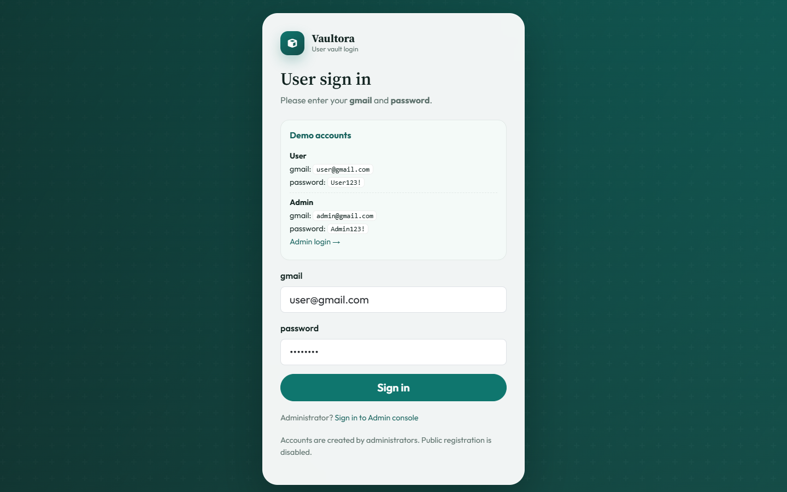
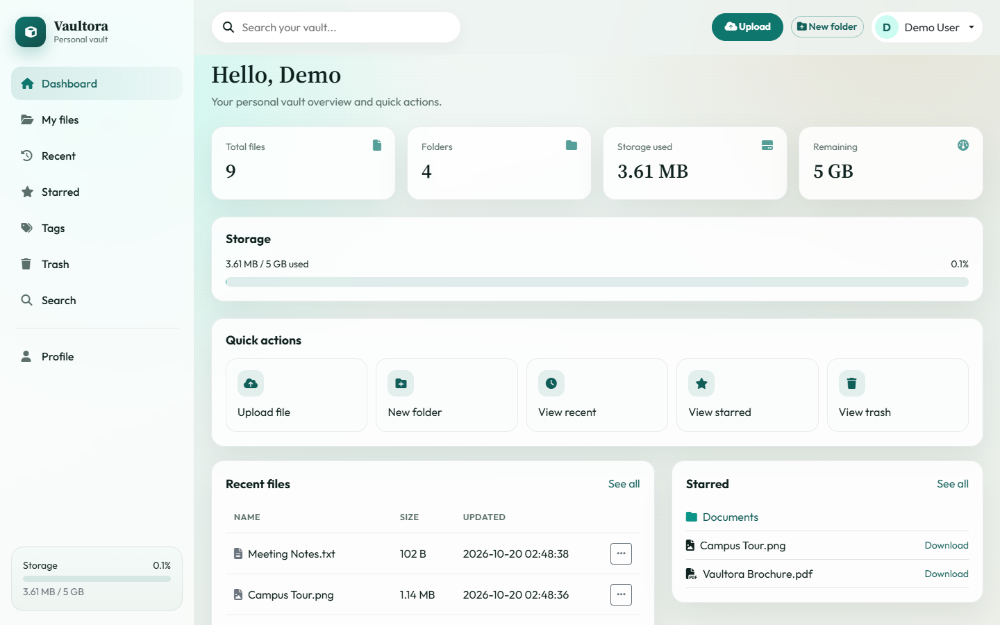
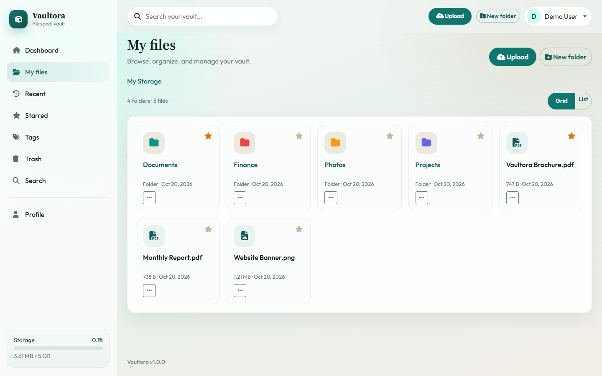
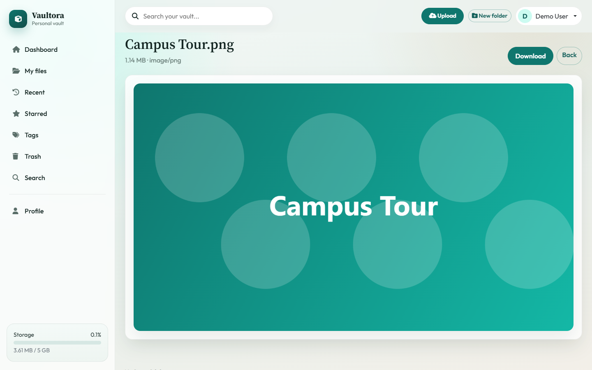
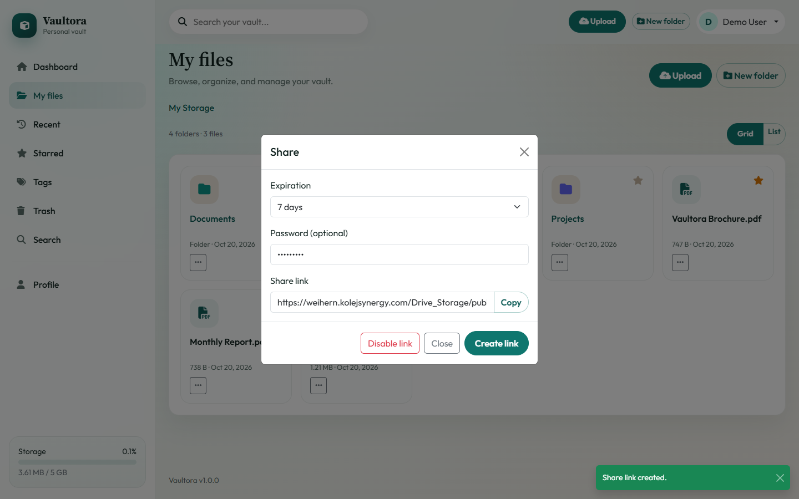
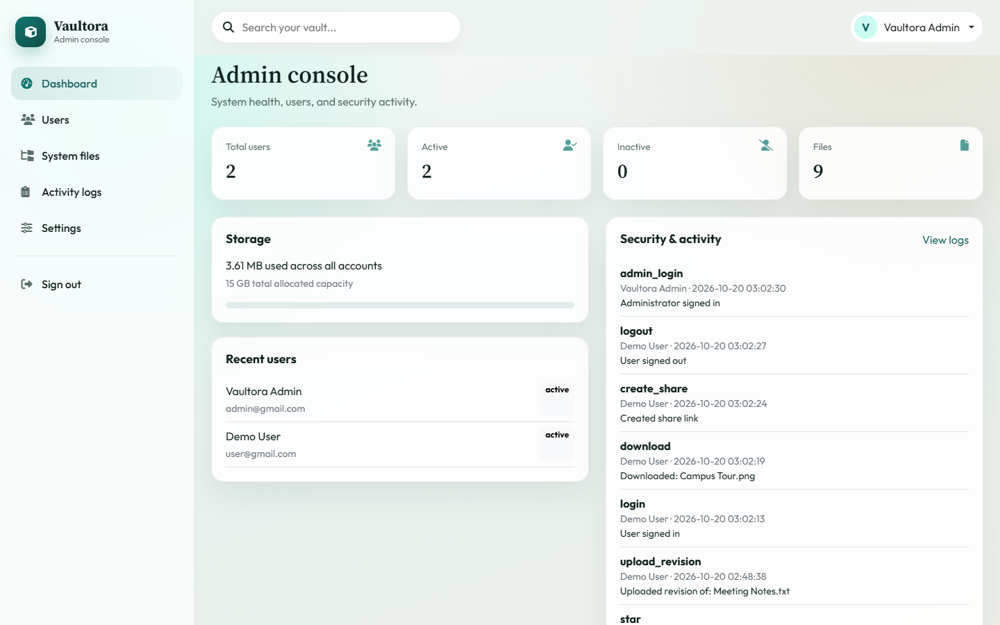

# Vaultora


Vaultora is a self-hosted, web-based file storage and management platform. It is written in plain PHP, MySQL/MariaDB, Bootstrap 5 and vanilla JavaScript, and runs on an ordinary XAMPP or cPanel stack without Node.js, Composer or a build step.

Users upload and organise files in nested folders, preview them in the browser, search, star and tag items, keep version history, recover deleted items from the trash, and share password-protected links. Administrators manage accounts, storage quotas, system settings, all stored files and the audit log.

There is **no public registration**: only administrators can create user accounts.

## Screenshots

| | |
| --- | --- |
|  **Sign in:** separate user and admin portals, Gmail + password login, no public registration. |  **Dashboard:** file and folder counts, storage quota usage, quick actions, recent and starred items. |
|  **My files:** coloured folders, grid/list views, breadcrumbs, stars and a per-item action menu. |  **Preview:** images, PDFs, text, audio and video open in the browser before downloading. |
|  **Share links:** public links with optional password and expiry, copy and disable in one click. |  **Admin console:** user totals, storage across all accounts, recent users and the security/activity log. |

<sub>Screenshots were taken from the live demo with sample files, captured at 1440×900 in headless Chrome.</sub>

## 中文简介

Vaultora 是一个可以自己架设的网页云端文件储存系统，类似一个精简版的个人网盘。它只用 PHP、MySQL 和原生 JavaScript 编写，可以直接在 XAMPP 或 cPanel 共享主机上运行，不需要 Node.js，也不需要编译。

- 用户功能：上传（支持拖放和多文件）、文件夹、预览、下载、重命名、移动、星标、标签、搜索、最近文件、回收站、版本历史和恢复、分享链接（可设密码和到期时间）、文件夹打包成 ZIP 下载。
- 管理员功能：新建、编辑、停用、删除用户，设置每个用户的储存空间，查看所有文件、操作日志，修改系统设置（上传大小、允许的文件类型、回收站保留天数）。
- 安全：密码用 `password_hash` 加密，PDO 预处理语句，CSRF 防护，XSS 转义，上传文件类型检查，`storage/` 文件夹禁止直接访问，每个用户只能看到自己的文件。
- 用户登录页：`/login.php`；管理员登录页：`/admin/login.php`。

## Features

| Area | What is implemented |
| --- | --- |
| Accounts | Separate user and admin login portals, hashed passwords, session regeneration on login, inactive accounts blocked, profile and password change |
| Files | Multi-file upload with drag-and-drop and progress, secure download, in-browser preview, rename, move, star, random stored filenames |
| Folders | Nested folders with colours, breadcrumbs, move/rename, starred folders |
| Organisation | Search, recent files, starred view, per-user tags with colours |
| Trash | Soft delete, restore, permanent delete, empty trash, retention period setting |
| Versions | Upload a new version of a file, view and download older versions, roll back |
| Sharing | Random-token public links, optional password, expiry (1/7/30 days or custom), disable link, folder ZIP download |
| Storage | Per-user quotas enforced before upload, usage meter on the dashboard and sidebar |
| Admin | Dashboard, create/edit/deactivate/delete users, reset passwords, change quotas, browse all files, activity log, system settings |
| Security | PDO prepared statements, CSRF tokens, `htmlspecialchars` escaping, extension + MIME checks, blocked executable types, `storage/` denied over HTTP, ownership checks on every resource |

## Technology

| Layer | Stack |
| --- | --- |
| Backend | PHP 8.3+ (native), PDO |
| Database | MySQL / MariaDB (InnoDB, utf8mb4) |
| Frontend | HTML5, CSS3, Bootstrap 5.3, Font Awesome 6, Google Fonts |
| JavaScript | Vanilla ES6+, Fetch / XHR |
| Server | Apache (XAMPP or cPanel) |

## Quick start (XAMPP, Windows)

1. Clone the project into XAMPP's web root:
   ```bat
   git clone https://github.com/weihern08/Drive-Storage.git C:\xampp\htdocs\Drive_Storage
   ```
2. Start **Apache** and **MySQL** in the XAMPP Control Panel.
3. Open the web installer and follow the steps:
   ```text
   http://localhost/Drive_Storage/install/
   ```
   The installer checks the environment, asks for the database host, name, user and password, creates the tables, writes `config/database.php`, creates the first administrator, and finally writes `config/installed.lock` so it cannot run again.
4. Sign in at `http://localhost/Drive_Storage/admin/login.php` with the administrator you created, then add users under **Admin → Users → Create user**.

## cPanel deployment (without the installer)

1. Upload the project to `public_html` or a subfolder.
2. Create a MySQL database and user in **cPanel → MySQL Databases**, and add the user to the database with **ALL PRIVILEGES**.
3. In **phpMyAdmin**, select the database and **Import** `database/cpanel_ready.sql`. This creates all tables, default settings and two demo accounts.
4. Copy `config/database.example.php` to `config/database.php` and fill in your database name, user and password.
5. Create `config/installed.lock` (any content) so the installer stays disabled.
6. Make sure `storage/` is writable (755 or 775).
7. Open `/login.php` (users) or `/admin/login.php` (administrators).

A step-by-step guide in Chinese is in [CPANEL部署说明.txt](CPANEL部署说明.txt).

### Demo accounts

`database/cpanel_ready.sql` creates these accounts for demos. Change the passwords before real use.

| Role | Gmail | Password | Login page |
| --- | --- | --- | --- |
| User | `user@gmail.com` | `User123!` | `/login.php` |
| Admin | `admin@gmail.com` | `Admin123!` | `/admin/login.php` |

## Project structure

```text
Drive_Storage/
├── index.php, login.php, logout.php     Entry and authentication
├── dashboard.php, files.php             Dashboard and file explorer
├── preview.php, download.php            Preview and secure download
├── search.php, recent.php, starred.php  Search and quick views
├── tags.php, trash.php, versions.php    Tags, trash and version history
├── share.php, public_share.php          Share management and public links
├── profile.php                          Profile and password
├── admin/                               Administrator console
├── api/                                 JSON endpoints used by assets/js/app.js
├── assets/css, assets/js                Styles and client script
├── config/                              App config and database credentials
├── database/cpanel_ready.sql            One-file import for cPanel
├── includes/                            Auth, helpers, domain logic, layouts
├── install/                             Web installer and schema.sql
├── storage/                             File vault (denied over HTTP)
└── docs/screenshots/                    README screenshots
```

## Security checklist

- [x] Authentication with `password_hash` / `password_verify`
- [x] `session_regenerate_id(true)` after login
- [x] Admin routes require the admin role
- [x] User-owned resources scoped by `user_id`
- [x] PDO prepared statements
- [x] CSRF tokens on state-changing actions
- [x] XSS escaping via the `e()` helper
- [x] Upload extension + MIME checks; dangerous types blocked
- [x] Random stored filenames; downloads through a controlled handler
- [x] `storage/`, `config/` and `includes/` denied over HTTP
- [x] Share access via random token, optional password and expiry
- [x] Storage quota enforced before upload
- [x] Activity / audit logging

## License

Released under the [MIT License](LICENSE).
